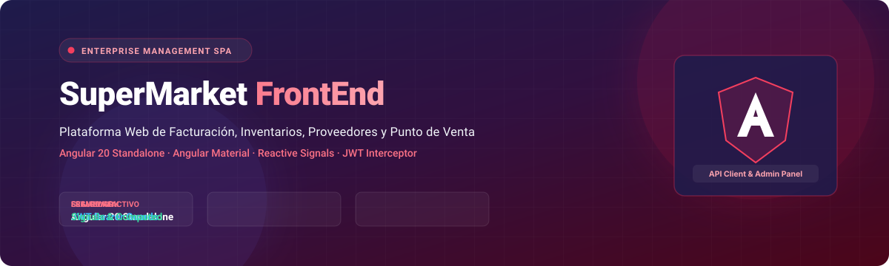
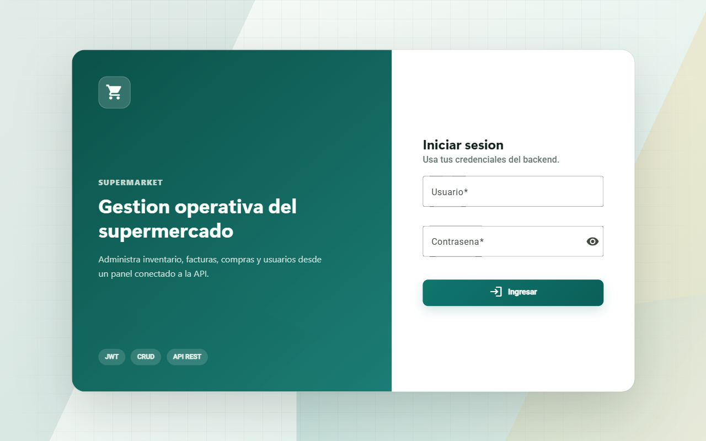
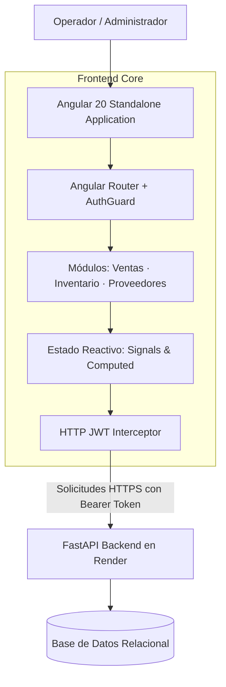

<p align="center">
  
</p>

<p align="center">
  <a href="https://santi-osp.github.io/superMarketFrontEnd/"></a>
  <a href="https://youtu.be/toM-GmfHZpo"></a>
  <a href="https://supermarketbackend.onrender.com/docs"></a>
  
  
  
</p>

<p align="center">
  
</p>

## 🛒 Visión General

**SuperMarket FrontEnd** es una aplicación web empresarial de administración comercial y punto de venta, desarrollada con **Angular 20** bajo el paradigma de *Standalone Components* y estilizada con **Angular Material**.

El cliente se conecta de forma reactiva a una API REST construida en **FastAPI**, implementando autenticación robusta mediante tokens **JWT**, intercepción automática de solicitudes HTTP, control de acceso mediante Guards en rutas protegidas (`/app`), y gestión de estado reactivo desacoplado con **Signals** (`signal` y `computed`).

---

## 🎬 Demostración en Video y Enlaces Públicos

<p align="center">
  <a href="https://youtu.be/toM-GmfHZpo">
    
  </a>
</p>

| Recurso | Enlace de Acceso Directo |
| :--- | :--- |
| **🌐 Frontend en Producción (GitHub Pages)** | [santi-osp.github.io/superMarketFrontEnd](https://santi-osp.github.io/superMarketFrontEnd/) |
| **⚡ Backend API en Producción (Render)** | [supermarketbackend.onrender.com](https://supermarketbackend.onrender.com) |
| **📄 Especificación Swagger OpenAPI** | [supermarketbackend.onrender.com/docs](https://supermarketbackend.onrender.com/docs) |
| **🐙 Repositorio del Backend** | [mengrau/superMarketBackEnd](https://github.com/mengrau/superMarketBackEnd) |

---

## 📸 Recorrido Visual de la Plataforma

### 🔐 Portal de Acceso Seguro (Login JWT)
Control de acceso con validaciones reactivas, almacenamiento protegido del token en `localStorage` y expiración automática de sesión.

<p align="center">
  
</p>

<p align="center">
  
</p>

## ⚡ Módulos y Alcance Funcional

- **🔐 Autenticación & Sesión:** Inicio de sesión con credenciales cifradas, interceptor HTTP para inyectar cabeceras `Authorization: Bearer <token>` y redirección automática en caso de token expirado (HTTP 401).
- **🧾 Facturación y Ventas:** Generación de facturas con cálculo en vivo de subtotales, impuestos (IVA) y descuentos; soporte para detalle multinivel y anulación auditada de transacciones.
- **📦 Control de Inventarios:** Catálogo de productos con categorías, stock mínimo de seguridad, control de alertas por agotamiento y kardex de movimientos.
- **🤝 Compras y Proveedores:** Registro de órdenes de compra recibidas, actualización directa de stock disponible y gestión de catálogo de proveedores autorizados.
- **📱 Navegación Lateral (Sidebar):** Menú colapsable adaptado a dispositivos móviles y escritorios para acceso rápido a cada submódulo operativo.

---

## 🏛️ Arquitectura del Sistema



---

## 🚀 Instalación y Puesta en Marcha Local

### Prerrequisitos
- **Node.js:** Versión 18.x, 20.x o 22.x LTS
- **Angular CLI:** `npm install -g @angular/cli@20`

### 1. Clonar el repositorio
```bash
git clone https://github.com/santi-osp/superMarketFrontEnd.git
cd superMarketFrontEnd
```

### 2. Instalar dependencias
```bash
npm install
```

### 3. Configuración de API
Para apuntar a tu backend local de FastAPI o al entorno de producción, configura `src/environments/environment.ts`:
```typescript
export const environment = {
  production: false,
  apiUrl: 'http://localhost:8000' // O 'https://supermarketbackend.onrender.com'
};
```

### 4. Iniciar servidor de desarrollo
```bash
npm run start
```
Abre tu navegador en `http://localhost:4200/`.

### 5. Compilación para producción
```bash
npm run build -- --configuration production
```

---

## 📁 Estructura del Código Fuente

```text
superMarketFrontEnd/
├── docs/
│   ├── images/
│   │   ├── banner.svg           # Hero banner vectorial
│   │   └── divider.svg          # Separador decorativo
│   └── screenshots/
│       └── login-screen.png     # Captura de pantalla oficial
├── public/                      # Recursos estáticos
├── src/
│   ├── app/
│   │   ├── core/                # Interceptores HTTP, servicios de auth y guards
│   │   ├── models/              # Interfaces y DTOs de TypeScript
│   │   ├── pages/               # Vistas principales (Login, Ventas, Inventarios)
│   │   ├── shared/              # Componentes visuales reutilizables de Material
│   │   └── app.routes.ts        # Definición de rutas protegidas
│   ├── environments/            # Variables de entorno dev/prod
│   ├── index.html
│   ├── main.ts                  # Bootstrap standalone de Angular
│   └── styles.scss              # Estilos globales y temas Material
├── angular.json
└── package.json
```

---

## 👨‍💻 Autor y Contacto

Desarrollado por **Santiago Ospina Arango**  
- **GitHub:** [@santi-osp](https://github.com/santi-osp)  
- **Demo en Vivo:** [santi-osp.github.io/superMarketFrontEnd](https://santi-osp.github.io/superMarketFrontEnd/)

---

<p align="center">
  <sub>SuperMarket FrontEnd · Desarrollado con Angular 20 y Material Design.</sub>
</p>